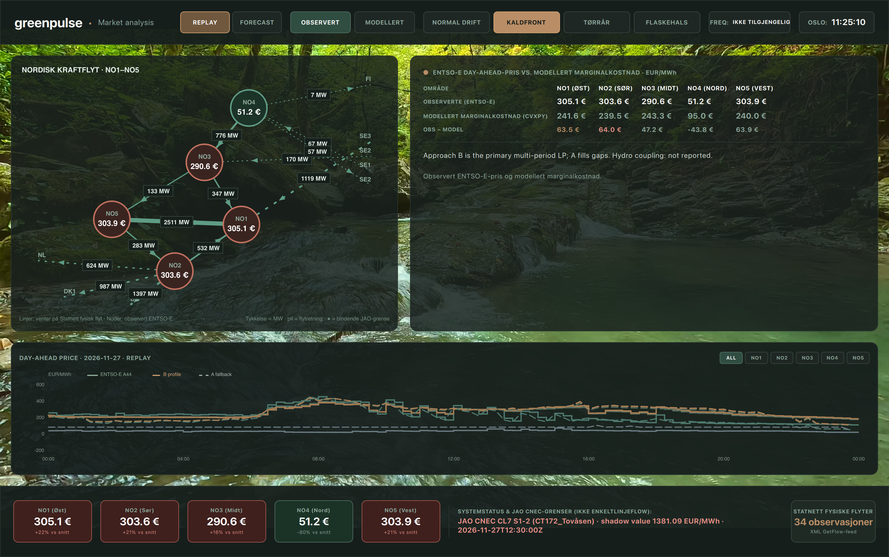

# GreenPulse

GreenPulse is a student project exploring **Nordic electricity-market modelling**. It combines market data, flow-based constraints and linear optimization in a small desktop application.

## What it does

- Retrieves day-ahead market data from ENTSO-E.
- Uses JAO flow-based domain data (CNECs, PTDFs and RAM) to represent cross-zonal network constraints.
- Compares two dispatch formulations: **Approach A** (single-period LP) and **Approach B** (multi-period LP).
- Displays model results and market data in a Qt/QML interface, with replay and forecast workflows.

## Tech stack

**Python · CVXPY · Qt/QML · C++ · ENTSO-E API · JAO data**

The project is an educational prototype, not a production trading system. Model outputs depend on input-data quality and simplified assumptions about generation costs, hydro and external markets.
